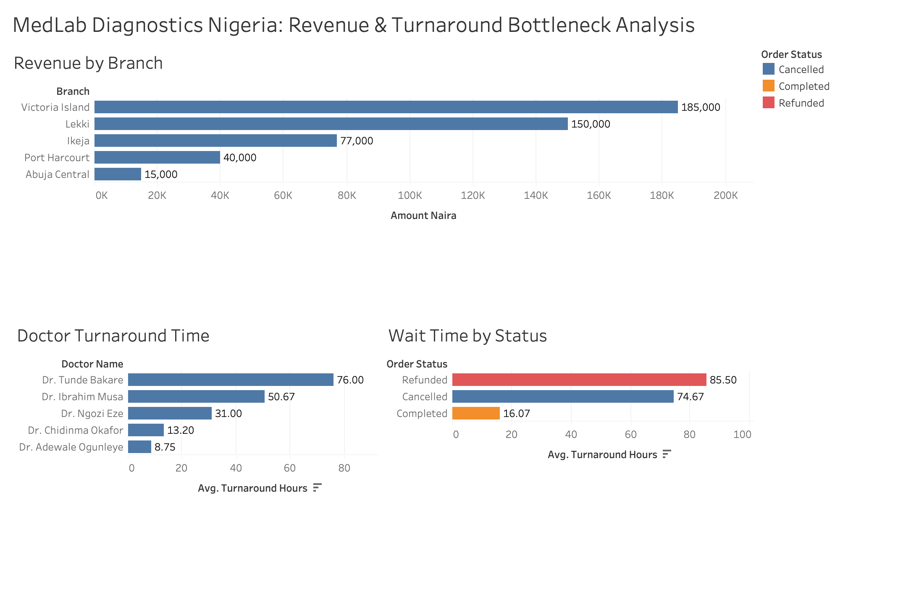

# 🏥 MedLab Diagnostics Nigeria: Revenue & Operations Bottleneck Analysis
**Tools Used:** MySQL (Data Cleaning, Joins & Aggregation) | Tableau (Executive Dashboard Visualization)

## 📌 Executive Summary
MedLab Diagnostics operates across 5 major branches in Nigeria (Victoria Island, Lekki, Ikeja, Port Harcourt, and Abuja Central). While top branches generate strong revenue, the company recently experienced a spike in **cancelled and refunded diagnostic tests**. 

I conducted an end-to-end SQL and Tableau analysis across transaction and doctor records to identify revenue drivers, quantify lost revenue, and pinpoint the operational root cause of patient cancellations.

---

## 📊 Executive Dashboard (Tableau)

---

## 🔍 Key Business Insights Uncovered (via SQL)
1. **Completed Revenue by Branch:** 
   - **Victoria Island** leads actual completed revenue at **₦185,000**, followed by **Lekki (₦150,000)** and **Ikeja (₦77,000)**.
   - **Port Harcourt (₦40,000)** and **Abuja Central (₦15,000)** significantly underperform in completed revenue.
2. **The Root Cause of Cancellations (Turnaround Time Bottleneck):**
   - Completed lab tests have an average turnaround time of just **16.07 hours**.
   - However, **Cancelled orders averaged 74.67 hours (3+ days)** and **Refunded orders averaged 85.50 hours (3.5+ days)**—proving that lab processing delays beyond 48 hours directly trigger patient cancellations and refund requests.
3. **Revenue Lost to Delays:**
   - A total of **₦159,000** (~25% of potential revenue) was lost to cancellations and refunds across Lekki (₦55,000), Port Harcourt (₦80,000), and Abuja Central (₦24,000).
4. **Staff Performance Bottleneck (`JOIN` Analysis):**
   - Joining transaction records with `Doctors_Info` revealed that **Dr. Tunde Bakare (Port Harcourt)** averages **76.0 hours** per test and **Dr. Ibrahim Musa (Abuja Central)** averages **50.67 hours**, compared to **8.75 hours** by Dr. Adewale Ogunleye (Ikeja) and **13.20 hours** by Dr. Chidinma Okafor (VI).

---

## 💡 Strategic Recommendations for Management
1. **Enforce a 24-Hour SLA Alert:** Implement automated lab alerts whenever a test exceeds 24 hours in processing, as data shows turnaround times under 24 hours result in near-zero cancellations.
2. **Operational Audit in Port Harcourt & Abuja:** Reallocate lab equipment or assistant technicians to support Dr. Tunde Bakare and Dr. Ibrahim Musa to bring their turnaround time down from 50–76 hours to the <16-hour benchmark set by Ikeja and Victoria Island.
